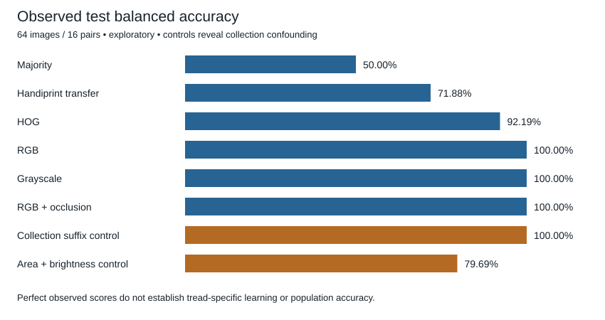

# Footwear Occlusion Robustness

A MGSC673 research project examining footwear-pattern classification under occlusion and cross-medium changes, using related ShoeCase Handiprint and synthetic-blood impressions.

## Research question
How does classification behave when impressions are partial or change recording medium, and how much can collection conditions explain apparently strong performance?

The blood subset compares two specific shoe styles: Adidas Seeley and Nike Zoom Winflo 4. Results do not establish general brand recognition or forensic identification.

## Data and experimental design
- 312 downloaded blood-on-tile images, representing 78 candidate shoe pairs rather than 312 independent shoes.
- Pair 81 excluded under the original split: 308 eligible images, 77 pairs.
- Training: 180 images / 45 pairs; validation and test: 64 images / 16 pairs each.
- Both sides, full/partial impressions and related media from a pair stay in one split.
- Frozen ImageNet ResNet18 with a trained linear head: RGB, grayscale and RGB with occlusion augmentation; seeds 0, 1 and 2. HOG and legacy Handiprint models provide comparisons.

## Recorded findings

The three blood-trained ResNet variants each classified all 64 test images correctly. HOG achieved 92.19% balanced accuracy; the original Handiprint model transferred to blood achieved 71.88%. A collection-suffix baseline also achieved 100%, and an area-plus-brightness baseline achieved 79.69%.

These are exploratory results from a small, previously examined test population. Perfect scores do not demonstrate tread-specific learning, equivalence between methods, or reliability on new collection conditions. See [limitations](docs/LIMITATIONS.md).

Detailed numbers: [aggregate result tables](tables/metrics.csv). Experiment history: [decision log](tables/experiment_decision_log.csv).

## Repository and private reproduction bundle
This is the code-and-results repository intended for public presentation, not the self-contained course submission. Source and derivative images, model weights, review archives, private manifests and image-bearing outputs are not included in the current code-and-results release. The author supplied the ShoeCase dataset record’s Licence field as CC BY 4.0; see [data provenance](docs/DATA_PROVENANCE.md). Public code alone cannot reproduce the numerical results without the private artifacts. No missing images are downloaded automatically.

1. Install `requirements.txt` in a compatible Python environment. GPU is recommended for optional fresh training; default execution reuses saved formal models.
2. Obtain the private reproduction bundle through an authorized channel. Its required layout is documented in [DATA_ACCESS.md](docs/DATA_ACCESS.md).
3. Set `FOOTWEAR_ANALYSIS_BUNDLE` to the extracted `MGSC673_Portable_Project` directory before running the notebook. Start Jupyter from the configured environment.
4. Open `notebooks/MGSC673_Project.ipynb` and run all. Keep the environment variable `FOOTWEAR_RUN_TRAINING` unset for the default mode. A first run can download the approximately 45 MB public ImageNet backbone and verifies its hash.

The final bundle adapter was independently exercised on the real prepared data using a Tesla T4 on 27 October 2026. All 12 fits were freshly trained; the validation losses and model SHA256 values matched the archived formal receipts exactly. The executed run completed 14 code cells. See the [full training log and receipts](evidence/reproduction_check/) and [validation comparison](evidence/reproduction_check/validation_comparison.json). This is a reproducibility check, not a new independent experiment or evidence of generalization across hardware. Fresh fits write separately and do not replace formal models.

## Status
- Completed: original GPU experiments; portable-bundle verification; timestamped stdout/stderr logs; real-data GPU retraining verification; final default execution and package-integrity checks.
- The final course-submission ZIP is frozen and remains separate from this GitHub presentation.
- Not implemented: a new blood occlusion-strength scan, unfreezing comparison or Grad-CAM study.

## Checks

Run `python scripts/check_notebook.py` and `python scripts/check_evidence.py` for dependency-free syntax and evidence checks. These do not train models or substitute for real-data reproduction. The public notebook has outputs removed; the private course submission retains executed outputs and the full report.

## Attribution and AI assistance
Dataset: Tibben, Carriquiry & McGuire (2023), *ShoeCase: A data set of mock crime scene footwear impressions*, https://doi.org/10.25380/iastate.22814438.v1.

Codex and Claude assisted with code, review, analysis and report drafting. The author remains responsible for understanding the work and following course policy. No open-source license is assigned in this initial repository; upstream data and model rights are separate.
