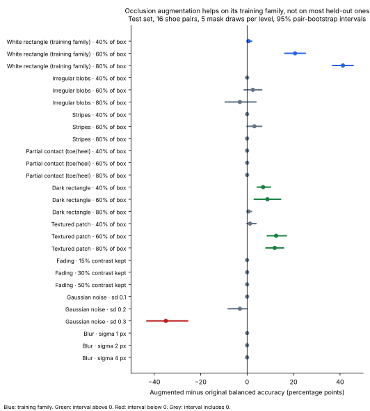
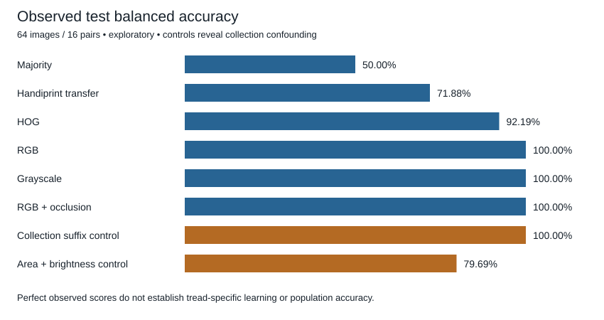

# Footwear Occlusion Robustness

**Question:** when a footwear impression is partly missing, or recorded in a different medium, does an image classifier still recognise the sole pattern, and how much of its apparent accuracy comes from collection artifacts instead of tread?

I study this with the public [ShoeCase](https://doi.org/10.25380/iastate.22814438.v1) dataset, comparing two specific shoe styles (Adidas Seeley and Nike Zoom Winflo 4) in clean ink "Handiprint" scans and in synthetic-blood impressions on tile. This is a methods study of evaluation and shortcut learning, **not** a brand-recognition or forensic-identification system.

## Key findings

| Investigation | Result (test set: 16 shoe pairs) | What it does and does not show |
| --- | --- | --- |
| **Severe synthetic occlusion** (Handiprint) | With 80% of the impression box masked by white rectangles, balanced accuracy is **53.75%** for the original CNN and **95.00%** for a CNN trained with occlusion augmentation (gain +41.25 pp, 95% pair-bootstrap CI 35.6–46.9) | Augmentation helps against **the same white-rectangle masks it was trained on**. |
| **Held-out occluders** (Handiprint) | Against irregular blobs or stripes the gain disappears (80% blobs: −3.1 pp, CI −9.4 to 3.7). Textured rectangles keep a partial gain (+11.9 pp at 80%). Under heavy noise the augmented model is **worse** (51.9% vs 86.9%, −35.0 pp) | The augmentation benefit is specific to rectangle-shaped occluders; it is not general occlusion robustness. [Details](experiments/occlusion_generalization/) |
| **Cross-medium transfer** | The Handiprint model scores **71.88%** on blood impressions (Nike recall 43.75%) | A change of recording medium causes a large drop. This is the most informative transfer result in the project. |
| **Blood-trained models** | RGB, grayscale and occlusion-augmented heads each classify **64/64** test images correctly | Not evidence of tread recognition: see the next row. |
| **Shortcut controls** | A baseline using only the filename collection suffix scores **100%**; crop geometry alone scores 93.75% on Handiprint; area + brightness scores 79.69% on blood | Collection conditions and shoe shape predict the class, so high accuracy alone cannot be attributed to tread pattern. |

All results are exploratory: the test pairs were examined before the occlusion extensions were designed.



## Approach

- **Leakage control.** Data are split by shoe pair, not by image. Both sides of a pair, and all of its full/partial and blood/ink impressions, stay in one split. The same pair split is used for both media, so no test shoe appears in training in either stage. Byte-identical files across splits are rejected.
- **Models.** Frozen ImageNet ResNet18 with a trained linear head (3 seeds, learning rate chosen on validation loss), compared with a HOG + logistic-regression baseline and a majority baseline.
- **Uncertainty.** 95% intervals come from a bootstrap that resamples whole shoe pairs within class (2,000 resamples), because left and right impressions of one shoe are not independent.
- **Shortcut probes.** Simple classifiers on nuisance variables (crop geometry, scan session, shoe size, collection suffix, brightness) estimate how much the label can be predicted without tread information.



## Repository guide

| Path | Contents |
| --- | --- |
| [`experiments/handiprint_gpu/`](experiments/handiprint_gpu/) | Handiprint stage: preprocessing, pair split, models, severe-occlusion extension, shortcut probes, GPU run evidence |
| [`experiments/occlusion_generalization/`](experiments/occlusion_generalization/) | Held-out occluder and degradation families (blobs, stripes, partial contact, dark and textured patches, fading, noise, blur) for the Handiprint models, with results, figures and the Colab notebook |
| [`notebooks/blood_stage.ipynb`](notebooks/blood_stage.ipynb) | Blood-on-tile stage: transfer, blood-trained heads, shortcut controls |
| [`tables/`](tables/) | Blood-stage metrics, confusion counts, paired differences and the [experiment decision log](tables/experiment_decision_log.csv) |
| [`evidence/`](evidence/) | Blood-stage GPU retraining receipts |
| [`docs/`](docs/) | [Data access](docs/DATA_ACCESS.md), [data provenance](docs/DATA_PROVENANCE.md), [limitations](docs/LIMITATIONS.md) |
| [`tests/`](tests/) | Unit tests for the occlusion families and pair bootstrap |

## Data

- **Handiprint:** 154 images from 77 shoe pairs after excluding pair 81 (unresolved in the image audit). Split: 45 / 16 / 16 pairs.
- **Blood on tile:** 308 images from the same 77 pairs (180 train, 64 validation, 64 test images). These are related observations, not 308 independent shoes. Seven pair identities are inferred from metadata; results excluding them are in `tables/metrics.csv` (cohort `exclude_metadata_inferred`).

The canonical shoe-pair split is in [`splits/`](splits/split_manifest_final.csv). The Handiprint stage can be reproduced from public sources alone: `scripts/fetch_handiprint_images.py` downloads the scans and checks each against the split's SHA-256. Images, model weights and the blood-stage input bundle are not in this repository. See [data access](docs/DATA_ACCESS.md).

## Checks you can run without the data

```bash
python scripts/check_notebook.py
python scripts/check_evidence.py
python scripts/check_handiprint_gpu.py
```

These standard-library scripts check that the notebooks parse with outputs cleared, and that the published receipts and result tables are internally consistent. They do not retrain models or verify accuracy.

The occlusion-family code has unit tests on synthetic images (needs `numpy`, `scipy` and `pytest`):

```bash
python -m pytest tests/
```

## Reproducibility record

- **Handiprint stage:** run end to end on a Tesla T4 (23 code cells). On 8 November 2026 it was retrained from scratch inside the occlusion-generalisation notebook. All 154 scans, re-downloaded from the public dataset, matched the manifest's SHA-256. The published test metrics, paired differences and shortcut-probe tables were reproduced exactly ([comparison](experiments/occlusion_generalization/outputs/handiprint_rerun_comparison.json)). See [the stage README](experiments/handiprint_gpu/).
- **Blood stage:** on 27 October 2026 all 12 heads were retrained on a Tesla T4. The validation losses and model SHA-256 values matched the saved models exactly ([receipts](evidence/reproduction_check/)). That run used the notebook as of commit `89df652`; later edits removed the report-generation code, simplified input-folder detection and rewrote text cells; the data-locking, training and analysis cells are unchanged.

## Limitations

Two shoe styles; 16 test pairs (8 per class); test pairs viewed before later experiments; synthetic corruptions that do not reproduce real crime-scene occlusion; an augmentation benefit that does not generalise beyond rectangle-shaped occluders; collection conditions confounded with class in the blood data. Details: [docs/LIMITATIONS.md](docs/LIMITATIONS.md).

## Dataset citation and license

Tibben, A., Carriquiry, A., & McGuire, M. (2023). *ShoeCase: A data set of mock crime scene footwear impressions*. Iowa State University. https://doi.org/10.25380/iastate.22814438.v1. Dataset license: CC BY 4.0 (see [data provenance](docs/DATA_PROVENANCE.md)).

Code in this repository is released under the [MIT License](LICENSE). The license does not cover the ShoeCase data or third-party model weights.
