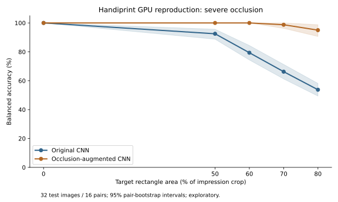

# Stage 1: Handiprint occlusion robustness — GPU reproduction

This stage investigates whether footwear-pattern classification degrades under simulated occlusion and whether occlusion-augmented training improves robustness. It is a **real Tesla T4 reproduction** of previously examined data, not a new independent confirmatory experiment. Historical CPU results and the frozen course submission remain unchanged.



## Design
- 154 eligible Handiprint images from 77 pairs; the immutable original split contains 45 training, 16 validation and 16 test pairs. Both sides of a pair stay together; pair 81 remains excluded.
- Grayscale image processing preserves aspect ratio and creates a white 224-pixel canvas. The historical preprocessing and mask definitions are retained.
- ImageNet ResNet18 with frozen backbone and a trained linear head; learning rates 0.001 and 0.01, seeds 0, 1 and 2, up to 40 epochs, early-stopping patience 7, batch 16. Selection uses validation loss; selected learning rate 0.01.
- The extension trains three additional heads with random white rectangles (probability 0.5, crop-area range 10–70%), retaining the selected learning rate. Clean validation log-loss selects checkpoints.
- Main and augmented CNN forward passes assert CUDA input and parameters. GPU feature extraction is also used in the exploratory sensitivity analysis. Image I/O, image processing, augmentation preparation, HOG/logistic regression, statistics and plotting still use CPU. This is not an entirely CPU-free pipeline.
- Unmodified HOG and CNN test balanced accuracy are both 100%; a majority baseline is 50%. The severe-mask experiment provides greater differentiation.

## Severe-occlusion results
Image-level balanced accuracy is averaged over five shared mask draws at each nonzero severity. Mask percentage means target rectangle area relative to the impression crop, not the fraction of tread pixels removed. Intervals resample whole shoe pairs within classes, with 2,000 paired draws.

| Target crop-area mask | Original CNN BA | Augmented CNN BA | Gain (percentage points) |
|---|---:|---:|---:|
| 0% | 100.00% | 100.00% | 0.00 |
| 50% | 92.50% | 100.00% | 7.50 |
| 60% | 79.38% | 100.00% | 20.63 |
| 70% | 66.25% | 98.75% | 32.50 |
| 80% | 53.75% | 95.00% | 41.25 |

At 80%, the paired 95% bootstrap interval for the gain is **35.63–46.88 percentage points**. These values agree with the rounded earlier report. This does not establish parameter-by-parameter agreement of historical CPU and GPU fits, equivalence across devices, or generalization to real occlusions.

[Metric table](tables/test_metrics.csv) · [Paired differences](tables/paired_model_differences.csv) · [Training curves](tables/cnn_learning_curves.csv) · [Augmented training histories](tables/occlusion_training_history.csv)

## Verification and boundaries
The uploaded result archive has 67 checksummed entries; all verified. The executed notebook completed 23 code cells without saved errors. Model bytes were checked against the main plan lock. All 10 extension metric rows and five paired interval rows were independently recomputed from saved predictions without additional inference. See [verification record](evidence/verification.json) and [execution log](evidence/gpu_execution_log.txt).

`audit_passed: false` in the original-format summary records that pair 81 remains unresolved. The canonical split excludes this pair, all 154 included records match original labels and source hashes, and no other pair was silently dropped. This rerun intentionally extracted only included TIFFs, so both sides of excluded pair 81 are absent locally; this is not new evidence about the original archive's missing-side status.

The public notebook has outputs cleared to avoid embedding image data and author paths. The original executed notebook, model binaries and full checksum manifest remain in the private result ZIP. Log paths are replaced by `<PROJECT_ROOT>` for publication; hashes of both original and published logs are recorded.

## Reproduce with authorized source inputs
The repository does not bundle TIFFs or model binaries. Obtain the ShoeCase Handiprint source data under the [dataset license](../../docs/DATA_PROVENANCE.md), the original `Handiprint_database.xlsx`, and the original manifest from the preserved submission bundle. Never draw a new split to replace the canonical file.

```
YOUR_PROJECT/
  data/
    Handiprint_database.xlsx
    split_manifest_final.csv
    Handiprint_images/       # paths must match matched_path in the manifest
```

The canonical manifest SHA256 is `20f942824a8c45c102837998cf2eb0b9f6d8cc9b243fa1ae87bef3db4f03d11d`. All 154 included images are checked by the notebook's audit. The pretrained ImageNet backbone may be downloaded on first use.

Install the root requirements and execution tools in a GPU environment. Run the helper from the repository root:

```bash
pip install -r requirements.txt
python scripts/run_handiprint_gpu.py --project-root /absolute/path/to/YOUR_PROJECT
```

The helper starts a new kernel in the same Python environment, creates a unique output folder, explicitly configures paths, saves outputs on failure, and preserves previous results. It does not download or extract raw data. The helper's orchestration has been checked syntactically; the submitted GPU run used the equivalent Colab launcher, not this new CLI wrapper.

## Interpretation
The extension was developed after earlier test review, and this reproduction reuses those pairs. Its gains are exploratory and conditional on the simulated-mask generator. The main and severe-extension masking procedures are not identical; comparisons within the severe extension share masks. Two shoe styles, collection conditions, size associations, preprocessing and the small number of independent test pairs limit broader claims. Baseline descriptor probes and grouped-CV analyses are diagnostic, not new held-out validation. A degenerate all-correct bootstrap interval is not evidence of perfect population accuracy.

This stage adds GPU provenance and traceable robustness analysis to the project's development history; it does not overwrite the separate blood-stage results or course submission. AI assistance is disclosed in the root README.
