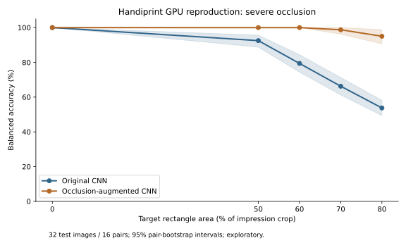

# Stage 1: Handiprint occlusion robustness

How much does footwear-pattern classification degrade when part of the impression is masked, and how much does occlusion-augmented training recover? This stage reruns the earlier CPU analysis on a Tesla T4 with the same split, preprocessing and mask rules.



## Design

- 154 Handiprint images from 77 shoe pairs; fixed split of 45 training, 16 validation and 16 test pairs, with both sides of a pair in the same split. Pair 81 is excluded because one side is missing.
- Grayscale preprocessing that preserves aspect ratio on a white 224-pixel canvas.
- Frozen ImageNet ResNet18 with a trained linear head: learning rates 0.001 and 0.01, seeds 0–2, up to 40 epochs, early stopping after 7, batch 16. Validation loss selected the learning rate (0.01).
- Occlusion augmentation: three more heads trained with random white rectangles (probability 0.5, covering 10–70% of the impression box), with checkpoints chosen on clean validation loss.
- On unmasked test images, both HOG and the CNN reach 100% balanced accuracy against 50% for a majority baseline, so severe masking is needed to separate the models.

## Results

Balanced accuracy is averaged over five shared mask draws per level. The mask level is the share of the impression box covered. Intervals resample whole shoe pairs within class (2,000 draws).

| Mask (share of box) | Original CNN | Augmented CNN | Gain (pp) |
|---|---:|---:|---:|
| 0% | 100.00% | 100.00% | 0.00 |
| 50% | 92.50% | 100.00% | 7.50 |
| 60% | 79.38% | 100.00% | 20.63 |
| 70% | 66.25% | 98.75% | 32.50 |
| 80% | 53.75% | 95.00% | 41.25 |

At 80% the 95% interval for the gain is **35.63–46.88 pp**. The 80% level lies just beyond the 10–70% training range, and the masks come from the same white-rectangle generator used in training. [Occlusion generalisation](../occlusion_generalization/) tests whether the gain carries over to other occluders; for most, it does not.

[Metric table](tables/test_metrics.csv) · [Paired differences](tables/paired_model_differences.csv) · [Training curves](tables/cnn_learning_curves.csv) · [Augmented training histories](tables/occlusion_training_history.csv)

## Shortcut probes

[Simple classifiers](tables/sensitivity_S1_shortcut_probes.csv) on unmasked test images reach 93.75% balanced accuracy from crop geometry alone (height, width, aspect ratio, ink fraction; interval 81.25–100%), 78.13% from scan session, and 96.88% from both. The class can be predicted almost as well from shoe shape as from tread, which is why the occlusion and fragment experiments matter.

## Verification

- The result archive has 67 checksummed entries, all verified; the notebook ran its 23 code cells without errors.
- All 10 extension metrics and 5 paired intervals were recomputed from the saved predictions ([verification record](evidence/verification.json), [execution log](evidence/gpu_execution_log.txt)).
- On 8 November 2026 the whole stage was retrained from scratch in the occlusion-generalisation notebook and reproduced every metric table exactly ([comparison](../occlusion_generalization/outputs/handiprint_rerun_comparison.json)).
- `audit_passed: false` in the summary refers to pair 81, which the split excludes.

## Reproduce

`python scripts/fetch_handiprint_images.py --project-root /path/to/YOUR_PROJECT` copies the split from [`splits/`](../../splits/split_manifest_final.csv) and downloads and verifies the ShoeCase scans and metadata ([data access](../../docs/DATA_ACCESS.md)). Then, in a GPU environment:

```bash
pip install -r requirements.txt
python scripts/run_handiprint_gpu.py --project-root /absolute/path/to/YOUR_PROJECT
```

The helper runs the notebook in a fresh kernel and writes to a new output folder. The recorded runs used Colab; the [occlusion-generalisation notebook](../occlusion_generalization/Occlusion_Generalization_Colab.ipynb) is the simplest way to rerun this stage there.
