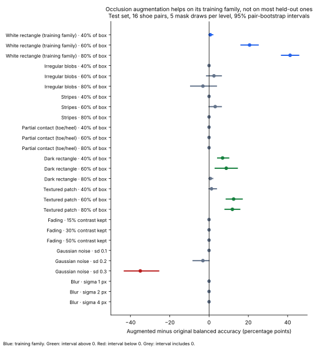

# Occlusion generalisation

**Question:** the occlusion-augmented Handiprint heads gained +41 percentage points at 80% masking, but they were trained and tested with the same white-rectangle generator. Does that benefit carry over to occluders and degradations they never saw?

**Answer:** mostly no. The gain is specific to rectangle-shaped occluders. It vanishes for irregular blobs and stripes, and the augmented model is much *less* robust to heavy noise.

## Results (test set: 32 images, 16 shoe pairs)

Balanced accuracy is averaged over 5 mask draws per level, with the same masks for both models. Intervals are 95% bootstrap intervals that resample whole shoe pairs within class (2,000 resamples).

| Family | Level | Original | Augmented | Gain (pp) [95% CI] |
|---|---|---:|---:|---:|
| White rectangle (training family) | 60% / 80% of box | 79.4 / 54.4 | 100.0 / 95.6 | +20.6 [16.2, 25.0] / **+41.3 [36.9, 45.6]** |
| Irregular blobs | 60% / 80% | 84.4 / 63.7 | 86.9 / 60.6 | +2.5 [−1.3, 6.2] / **−3.1 [−9.4, 3.7]** |
| Stripes | 60% / 80% | 63.1 / 50.0 | 66.2 / 50.0 | +3.1 [0.0, 6.2] / 0.0 |
| Partial contact (toe or heel missing) | 40–80% | 100.0 | 100.0 | 0.0 |
| Dark rectangle | 40% / 60% / 80% | 90.6 / 67.5 / 51.2 | 97.5 / 76.2 / 51.9 | +6.9 [4.4, 10.0] / +8.7 [3.1, 14.4] / +0.6 [0.0, 1.9] |
| Textured patch | 60% / 80% | 83.1 / 59.4 | 95.6 / 71.2 | +12.5 [8.7, 16.9] / +11.9 [8.1, 15.6] |
| Fading (15–50% contrast kept) | all | 100.0 | 100.0 | 0.0 |
| Gaussian noise | sd 0.2 / sd 0.3 | 100.0 / 86.9 | 96.9 / 51.9 | −3.1 [−8.1, 0.0] / **−35.0 [−43.1, −25.6]** |
| Blur | sigma 1–4 px | 100.0–93.8 | 100.0–93.8 | 0.0 |

Every level is in [`outputs/metrics.csv`](outputs/metrics.csv) and [`outputs/paired_differences.csv`](outputs/paired_differences.csv). [Accuracy curves for all families](assets/accuracy_by_family.svg).

## What the results show

1. **The headline gain replicates on its own family.** With freshly drawn masks, the augmented heads gain +41.3 pp at 80% (published value with the original draws: +41.25 pp).
2. **It does not transfer to differently shaped white occluders.** For blobs and stripes the gain is within about ±3 pp at every level, and the intervals include or touch zero. At 80% both models are close to chance.
3. **It partly transfers to rectangle-shaped occluders of another colour.** Textured patches keep a +12 pp gain at 60–80%. Dark rectangles gain +7 to +9 pp at 40–60%, but both models are near chance at 80%. What the augmentation learned seems tied to the rectangle's shape more than to "missing tread" in general.
4. **The augmentation makes the model less robust to heavy noise.** At noise sd 0.3 the augmented heads fall to 51.9% against 86.9% for the original. They label most noisy images Nike: the mean Nike score for Adidas impressions is 0.77, against 0.40 for the original heads.
5. **A contiguous toe or heel fragment is enough for both models, and not because of where it sits.** Removing 80% of the impression's length (about 83% of its ink) leaves both at 100%. The [follow-up](#follow-up-fragment-position) moved the fragment and found no drop, so the fragment's position (a possible shoe-length cue) does not explain this.
6. **The validation split shows the same pattern:** +40.6 pp for white rectangles at 80%, −11.3 pp for blobs, +16.9 pp for textured patches and −36.3 pp for noise sd 0.3.

**Mask level is not ink removed.** At the same nominal level, rectangles remove more ink than the other shapes: about 91% of tread darkness at 80%, against 80–83% for blobs, stripes and partial contact (`outputs/mask_log_test.csv.gz`). The augmented model does worse on blobs than on rectangles despite losing less ink, which strengthens point 2.

## Follow-up: fragment position

**Why:** in the main run, a toe or heel fragment kept at its original position on the canvas could reveal the shoe's length, and crop geometry alone predicts the class at 93.75% on clean images.

**Design (fixed before running):** [`Partial_Contact_Followup_Colab.ipynb`](Partial_Contact_Followup_Colab.ipynb) removes the same toe or heel rows as `partial_contact` (same random draws), then moves the remaining fragment to the centre of the canvas (`partial_contact_centered`) or to a random height (`partial_contact_shifted`). If accuracy stays near 100%, the result reflects the fragment's content; if it falls, position was carrying information.

**Result (Colab T4, 9 November 2026; test set, 16 pairs):**

| Fragment position | Level | Original | Augmented |
|---|---|---:|---:|
| In place | 40 / 60 / 80% removed | 100 / 100 / 100 | 100 / 100 / 100 |
| Centred | 40 / 60 / 80% | 100 / 100 / 100 | 100 / 100 / 100 |
| Random height | 40 / 60 / 80% | 100 / 100 / 99.4 | 100 / 100 / 100 |

Moving the fragment does not lower accuracy, and confidence barely changes: the mean probability given to the true class at 80% is 0.87 / 0.90 / 0.90 (original, in place / centred / random) and 0.95 / 0.94 / 0.96 (augmented). On the validation split, the only drop is the augmented model on centred fragments at 80% (94.4%, CI 88.1–100). **Conclusion: fragment position is not the cue.** A contiguous toe or heel region carries enough pattern information on its own.

This sharpens the main result. At the 80% level, blobs and stripes remove slightly less ink than partial contact (about 80–82% against 83%), yet they bring both models close to chance, while partial contact leaves them at 100%. What hurts these models appears to be how the remaining tread is broken up, more than how much is removed. A direct test would vary fragmentation at fixed ink loss.

Checks: the in-place family reproduced the main run's 960 test predictions exactly (largest score difference 0.0), and the 80% white-rectangle sanity check again gave 53.75% / 95.00%. Outputs: [`outputs/partial_contact_followup/`](outputs/partial_contact_followup/).

The fragment's width was not changed, so width-based size cues remain possible.

## Limits

- The 16 test pairs were used in earlier experiments. The families and levels were fixed in [`outputs/evaluation_plan.json`](outputs/evaluation_plan.json) before this run, and every family is reported.
- 8 pairs per class; intervals resample pairs with the mask draws held fixed.
- All corruptions are simulated.

## Reproducibility

- **Run:** Colab Tesla T4, 8 November 2026, with the [notebook](Occlusion_Generalization_Colab.ipynb).
- **Same data:** all 154 Handiprint scans were re-downloaded from the public ShoeCase `Handiprint Images.zip`, and each one matched the SHA-256 in the canonical split manifest.
- **Same models:** the notebook retrained the Handiprint stage from scratch. The published test metrics, paired differences and shortcut-probe tables were reproduced exactly, and the learning curves differ by less than 1e-6 ([comparison](outputs/handiprint_rerun_comparison.json)). The weight files differ byte-for-byte from the published ones (PyTorch 2.14.1 against 2.11.0) and give identical predictions on every reported test.
- **Figures:** `python make_figures.py` redraws them from the CSV outputs.

## Files

| File | Contents |
|---|---|
| `occlusion_families.py` | Corruption families, pair bootstrap, evaluation loop (NumPy/SciPy) |
| `Occlusion_Generalization_Colab.ipynb` | GPU notebook: sets up public inputs if missing, locks the plan, re-runs the Handiprint stage, checks the 80% result, evaluates validation and test, packages outputs |
| `Partial_Contact_Followup_Colab.ipynb` | Same pipeline for the fragment-position follow-up |
| `build_notebooks.py`, `notebook_cells.py` | Generate both notebooks from one source |
| `make_figures.py` | Draws `assets/*.svg` from the outputs |
| `outputs/` | Plan, metrics, paired differences, per-image predictions and mask logs (no images) |
| `../../tests/test_occlusion_families.py` | Unit tests on synthetic images |
